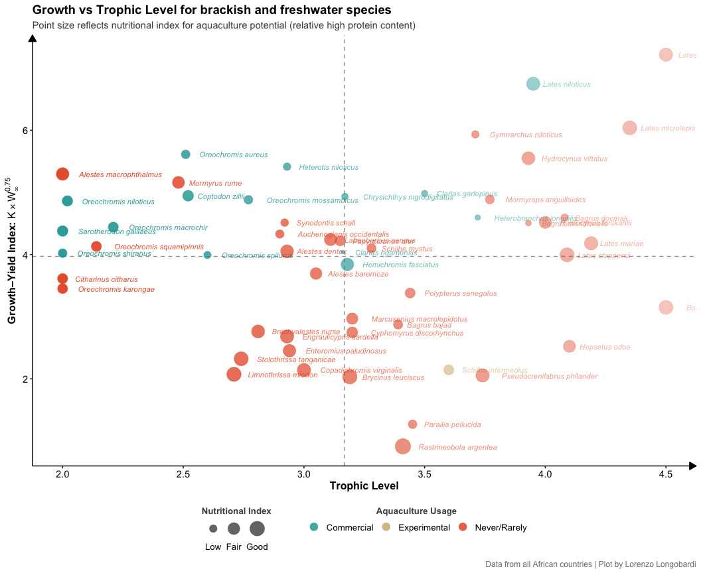

# Growth vs trophic level for freshwater and brackish fish


Which native freshwater and brackish-water fish combine a low trophic
level with high growth-yield and good nutrient content?

Each species is looked at along four lines:

1.  **W∞ (Winfinity)**: mass potential.
2.  **K or φ′ (PhiPrime)**: time dimension.
3.  **Feeding guild and feedability**: practicality.
4.  **Trophic level**: sustainability.

## Setup

``` r
devtools::load_all("..")

africa_ccodes <- c(
  "012",
  "024",
  "072",
  "108",
  "120",
  "132",
  "140",
  "148",
  "174",
  "178",
  "180",
  "204",
  "226",
  "230",
  "262",
  "266",
  "270",
  "288",
  "324",
  "384",
  "404",
  "430",
  "434",
  "450",
  "454",
  "466",
  "478",
  "480",
  "504",
  "508",
  "516",
  "562",
  "566",
  "638",
  "646",
  "654",
  "678",
  "686",
  "690",
  "694",
  "706",
  "710",
  "728",
  "736",
  "748",
  "788",
  "768",
  "800",
  "818",
  "854",
  "894",
  "716",
  "732",
  "F111"
)
```

## Data from FishBase

Native freshwater and brackish-water species for every country in
FishBase.

``` r
country <- rfishbase::country()
codes <- unique(country$C_Code)

#tdat <- get_fishbase_data(country_codes = c("566", "404", "834", "404"))
tdat <- get_fishbase_data(country_codes = africa_ccodes)
```

## Growth-yield and nutritional indices

W∞ (Winfinity) is the asymptotic body weight of a species: the
theoretical maximum average mass an individual can reach under ideal
conditions, according to growth models. K is the von Bertalanffy growth
coefficient, which controls how fast a fish approaches its asymptotic
size in the growth model (W∞).

K × W∞^0.75 is a composite index that approximates a species’ potential
rate of biomass accumulation, combining how fast it grows (K) with how
large it can ultimately become (W∞), while accounting for the fact that
growth efficiency decreases with size. The 0.75 exponent corrects for
biological scaling, so very large species do not appear unrealistically
efficient compared to smaller, faster-growing ones.

The nutritional index comes from `calculate_aquaculture_index()` in
[`R/processing.R`](../R/processing.R).

``` r
pdat <-
  tdat |>
  dplyr::mutate(aquaindex = K * w_inf^0.75) |>
  #dplyr::filter(feeding_guild %in% c("planktivore", "herbivore")) |>
  dplyr::select(
    species_name,
    FoodTroph,
    aquaindex,
    UsedforAquaculture,
    Importance,
    PriceCateg,
    Calcium:Zinc
  ) |>
  na.omit() |>
  dplyr::distinct() |>
  calculate_aquaculture_index() |>
  dplyr::select(-c(Calcium:Zinc)) |>
  #convert taxa to format G. species
  dplyr::mutate(
    UsedforAquaculture = stringr::str_to_title(UsedforAquaculture),
    # species_name = paste0(
    #   substr(species_name, 1, 1),
    #   ". ",
    #   sub("^\\S+ ", "", species_name)
    # )
  ) |>
  dplyr::group_by(species_name) |>
  dplyr::summarise(
    dplyr::across(dplyr::everything(), ~ dplyr::first(.x)),
    .groups = "drop"
  )
```

## Figure

``` r
library(ggplot2)
ggplot(
  pdat,
  aes(x = FoodTroph, y = log(aquaindex))
) +
  geom_hline(
    yintercept = mean(log(pdat$aquaindex), na.rm = TRUE),
    linetype = "dashed",
    color = "grey40",
    alpha = 0.7,
    linewidth = 0.5
  ) +
  geom_vline(
    xintercept = mean(pdat$FoodTroph, na.rm = TRUE),
    linetype = "dashed",
    color = "grey40",
    alpha = 0.7,
    linewidth = 0.5
  ) +
  geom_text(
    aes(label = species_name, alpha = -FoodTroph, color = UsedforAquaculture),
    size = 3,
    hjust = -0.2,
    vjust = 0.5,
    show.legend = FALSE,
    fontface = "italic"
  ) +
  geom_point(
    aes(
      alpha = -FoodTroph,
      size = aquaculture_index,
      color = UsedforAquaculture
    ),
    stroke = 0.3
  ) +
  scale_size_continuous(
    name = "Nutritional Index",
    range = c(1.5, 8),
    breaks = c(0.2, 0.4, 0.6, 0.8, 1.0),
    labels = c("Low", "Fair", "Good", "High", "Excellent"),
    guide = guide_legend(
      title.position = "top",
      title.hjust = 0.5,
      override.aes = list(alpha = 0.8, color = "grey30"),
      direction = "horizontal",
      nrow = 1,
      label.position = "bottom"
    )
  ) +
  scale_color_manual(
    name = "Aquaculture Usage",
    values = wesanderson::wes_palette("AsteroidCity1"),
    guide = guide_legend(
      title.position = "top",
      title.hjust = 0.5,
      override.aes = list(size = 4, alpha = 0.8),
      direction = "horizontal",
      nrow = 1
    )
  ) +
  scale_alpha_continuous(range = c(0.3, 0.9)) +
  labs(
    title = "Growth vs Trophic Level for brackish and freshwater species",
    subtitle = "Point size reflects nutritional index for aquaculture potential (relative high protein content)",
    x = "Trophic Level",
    y = expression(bold("Growth–Yield Index: ") * K %*% W[infinity]^0.75),
    caption = "Data from all African countries | Plot by Lorenzo Longobardi"
  ) +
  theme_minimal(base_size = 11) +
  theme(
    axis.line = element_line(
      arrow = arrow(length = unit(0.3, "cm"), type = "closed")
    ),
    panel.border = element_blank(),
    panel.grid = element_blank(),
    axis.ticks = element_line(),
    axis.text = element_text(size = 11, color = "black"),
    legend.position = "bottom",
    legend.box = "horizontal",
    legend.spacing.x = unit(1, "cm"),
    legend.title = element_text(size = 10, face = "bold", color = "grey30"),
    legend.text = element_text(size = 10),
    plot.title = element_text(size = 14, face = "bold"),
    plot.subtitle = element_text(size = 11, color = "grey30"),
    plot.caption = element_text(size = 9, color = "grey50"),
    axis.title = element_text(size = 12, face = "bold"),
    panel.background = element_rect(fill = "white", color = NA),
    plot.background = element_rect(fill = "white", color = NA)
  ) +
  guides(alpha = "none")
```



## Next steps

1.  Add environmental tolerance.
2.  Breeding in captivity.
3.  Polyculture?
4.  Production of candidates from FishBase. Draft code, not run yet:
